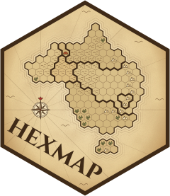

<!-- README.md is generated from README.Rmd. Please edit that file -->

```{r, include = FALSE}
knitr::opts_chunk$set(
  collapse = TRUE,
  comment = "#>",
  fig.path = "man/figures/README-",
  out.width = "100%",
  dpi = 150
)
```

# hexmap <a href="https://numbats.github.io/hexmap/"></a>

<!-- badges: start -->
[](https://lifecycle.r-lib.org/articles/stages.html#experimental)
<!-- badges: end -->

hexmap converts a map of regions into a map of equally sized hexagons, one for each region. Every region gets the same amount of ink, so small but important regions (such as inner-city electorates) are as visible as large, sparsely populated ones, while each region stays close to where it is on the map.

## Installation

You can install the development version of hexmap like so:

``` r
install.packages("remotes")
remotes::install_github("numbats/hexmap")
```

## Usage

`hexmap()` takes an `sf` object and returns it with each region's geometry replaced by a hexagon:

``` r
library(hexmap)
hexmap(electorates)
hexmap(electorates, group = state)
```

* **Optimal placement.** Each region gets the hexagon that minimises the total squared distance between regions and their hexagons, so the relative positions of regions are kept.
* **Groups.** With `group`, the hexagons of each group (such as a state) are kept together, separated by a small gap (`group_gap`), and touch the same neighbouring groups as on the map.
* **Group layouts.** `group_layout` sets how groups are arranged: warped into a cartogram that keeps each group's shape (`layout_diffusion()`, the default), compact blocks (`layout_compact()`), a spatial treemap (`layout_slice()`), or groups that keep their own shapes at the expense of the overall outline (`layout_hierarchy()`). `layout_repair()` fixes the borders between groups of any layout.
* **Islands.** Distant landmasses, such as Tasmania, are tiled separately and kept apart from the mainland (`island_gap`).
* **Projections.** Hexagons are regular in the projection they are made in (`crs`), which defaults to an equal-area projection for maps in longitude and latitude. See `vignette("projections")`.

The two steps of `hexmap()` are also available on their own: `hex_grid()` tiles a map with hexagons, and `tile_allocate()` allocates them to regions.

## Example: the 2025 Australian federal election

Labor won 94 of the 150 seats at the 2025 Australian federal election. On a geographic map the result looks like a Coalition win, as the large rural divisions hide Labor's many small city seats. A cartogram with equal areas for each division shows the number of seats, but distorts the map beyond recognition. A hexagon grid made with [geogrid](https://github.com/jbaileyh/geogrid) gives each division the same space, but doesn't keep states together. hexmap keeps each state together, in its place and with its neighbours.

```{r animation, echo = FALSE, message = FALSE, fig.width = 7, fig.height = 6.5, dpi = 100, fig.show = "animate", animation.hook = "gifski", interval = 1/20}
library(sf)
library(ggplot2)
library(hexmap)

party <- c(ALP = "Labor", LP = "Coalition", LNP = "Coalition", NP = "Coalition",
           GRN = "Greens")
colours <- c(Labor = "#D7263D", Coalition = "#1F4E9C", Greens = "#2E9E44", Other = "#8C8C8C")
election <- st_transform(aus_election2025, 3577)
election$party <- ifelse(election$party %in% names(party), party[election$party], "Other")
election_hexmap <- hexmap(election, group = state, group_layout = layout_hierarchy())

# Resample a closed ring to n points equally spaced along its boundary, anticlockwise
resample_ring <- function(xy, n = 60) {
  if (sum(xy[-1, 1] * xy[-nrow(xy), 2] - xy[-nrow(xy), 1] * xy[-1, 2]) < 0) xy <- xy[nrow(xy):1, ]
  s <- c(0, cumsum(sqrt(rowSums(diff(xy)^2))))
  at <- seq(0, max(s), length.out = n + 1)[-(n + 1)]
  cbind(approx(s, xy[, 1], at, ties = mean)$y, approx(s, xy[, 2], at, ties = mean)$y)
}

# Pair the outer ring of each part of each region with its hexagon, starting
# the hexagon at the point that best matches the ring
morph_rings <- function(from, to, n = 60) {
  do.call(rbind, lapply(seq_along(from), function(i) {
    hex <- resample_ring(st_coordinates(to[[i]])[, 1:2], n)
    parts <- lapply(unclass(st_cast(from[i], "POLYGON")), function(p) p[[1]])
    do.call(rbind, lapply(seq_along(parts), function(j) {
      ring <- resample_ring(parts[[j]], n)
      cost <- sapply(0:(n - 1), function(k) sum((ring - hex[(seq_len(n) + k - 1) %% n + 1, ])^2))
      hex <- hex[(seq_len(n) + which.min(cost) - 2) %% n + 1, ]
      data.frame(region = i, ring = paste(i, j),
                 x0 = ring[, 1], y0 = ring[, 2], x1 = hex[, 1], y1 = hex[, 2])
    }))
  }))
}

rings <- morph_rings(st_geometry(election), st_geometry(election_hexmap))
rings$party <- election$party[rings$region]

# Pause on the map, ease into the hexagons, pause, then ease back
t <- c(rep(0, 10), (1 - cos(pi * seq(0, 1, length.out = 30))) / 2, rep(1, 15))
for (t in c(t, rev(t))) {
  frame <- transform(rings, x = x0 + t * (x1 - x0), y = y0 + t * (y1 - y0))
  print(
    ggplot(frame, aes(x, y, group = ring, fill = party)) +
      geom_polygon(colour = "white", linewidth = 0.1) +
      scale_fill_manual(values = colours, breaks = names(colours), name = NULL) +
      coord_equal(xlim = range(rings$x0, rings$x1), ylim = range(rings$y0, rings$y1)) +
      theme_void() +
      theme(legend.position = "bottom")
  )
}
```

hexmap includes the results as `aus_election2025`: the simplified boundaries of each division from the [Australian Bureau of Statistics](https://www.abs.gov.au/), with its state and the party that won it from the [Australian Electoral Commission](https://www.aec.gov.au/), licensed under CC BY 4.0. The maps below are made in the Australian Albers equal-area projection, with the minor parties combined:

```{r election-data, message = FALSE}
library(sf)
library(hexmap)

party <- c(ALP = "Labor", LP = "Coalition", LNP = "Coalition", NP = "Coalition",
           GRN = "Greens")
election <- st_transform(aus_election2025, 3577)
election$party <- ifelse(election$party %in% names(party), party[election$party], "Other")
```

Each method then gives every division the same area:

```{r election-maps, message = FALSE}
library(cartogram)
library(geogrid)

# Cartogram
election$seats <- 1
election_cartogram <- cartogram_cont(election, "seats", itermax = 20)

# geogrid
grid <- calculate_grid(election, grid_type = "hexagonal", seed = 1)
election_geogrid <- assign_polygons(election, grid)

# hexmap
election_hexmap <- hexmap(election, group = state)
```

```{r comparison, echo = FALSE, message = FALSE, fig.width = 8, fig.height = 7}
library(ggplot2)
library(patchwork)

colours <- c(Labor = "#D7263D", Coalition = "#1F4E9C", Greens = "#2E9E44", Other = "#8C8C8C")
election_map <- function(map, title) {
  # Merge each state's regions, closing small gaps between them
  d <- 0.03 * sqrt(median(as.numeric(st_area(map))))
  states <- aggregate(st_buffer(map["state"], d), list(map$state), length)
  states <- st_buffer(st_buffer(states, -d), 0)
  ggplot(map) +
    geom_sf(aes(fill = party), colour = "white", linewidth = 0.1) +
    geom_sf(data = states, fill = NA, colour = "black", linewidth = 0.3) +
    scale_fill_manual(values = colours, breaks = names(colours), name = NULL) +
    labs(title = title) +
    theme_void()
}

election_map(election, "Geographic map") +
  election_map(election_cartogram, "Cartogram") +
  election_map(election_geogrid, "geogrid") +
  election_map(election_hexmap, "hexmap, grouped by state") +
  plot_layout(nrow = 2, guides = "collect") &
  theme(legend.position = "bottom")
```

Colouring the divisions by state shows the difference. geogrid scatters the divisions of each state across the grid, so four of Tasmania's five seats end up on the mainland. hexmap keeps each state in one piece, touching the same states as on the map.

```{r states, echo = FALSE, fig.width = 8, fig.height = 3.5}
state_map <- function(map, title) {
  ggplot(map) +
    geom_sf(aes(fill = state), colour = "white", linewidth = 0.1) +
    scale_fill_manual(values = unname(palette.colors(8, "Set 2")), name = NULL) +
    labs(title = title) +
    theme_void()
}

state_map(election_geogrid, "geogrid") +
  state_map(election_hexmap, "hexmap, grouped by state") +
  plot_layout(guides = "collect")
```

The code for the plots (with ggplot2 and patchwork) is in [`README.Rmd`](README.Rmd).

## Related

- [geogrid](https://github.com/jbaileyh/geogrid) allocates regions to a regular grid of hexagons or squares.
- [cartogram](https://github.com/sjewo/cartogram) distorts regions so their areas are proportional to a variable.
