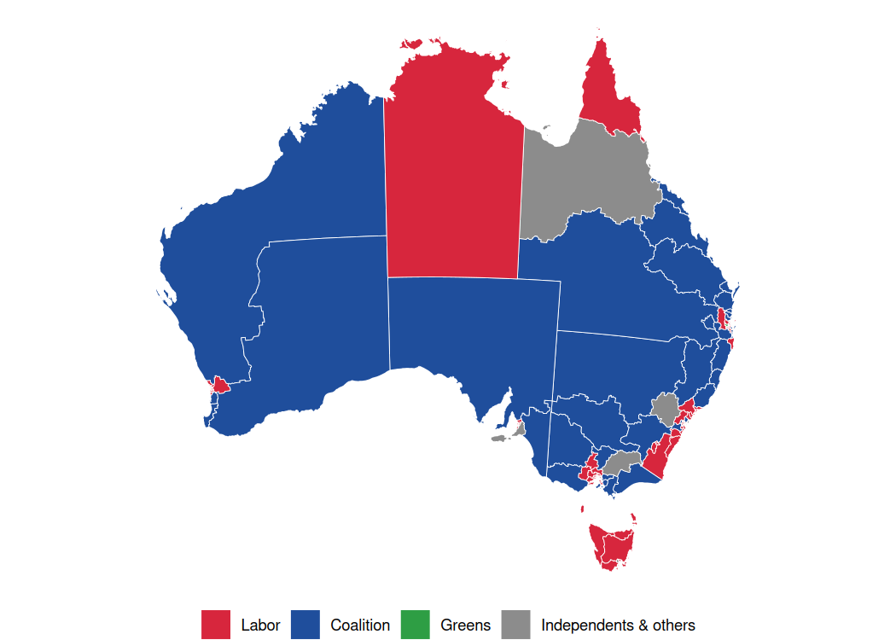
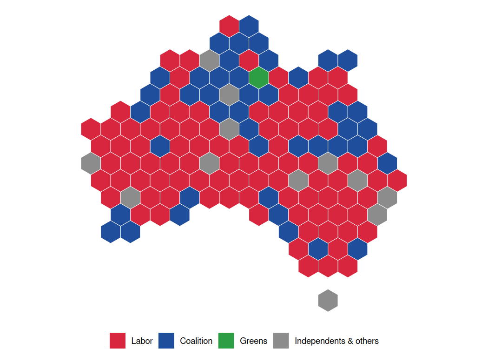
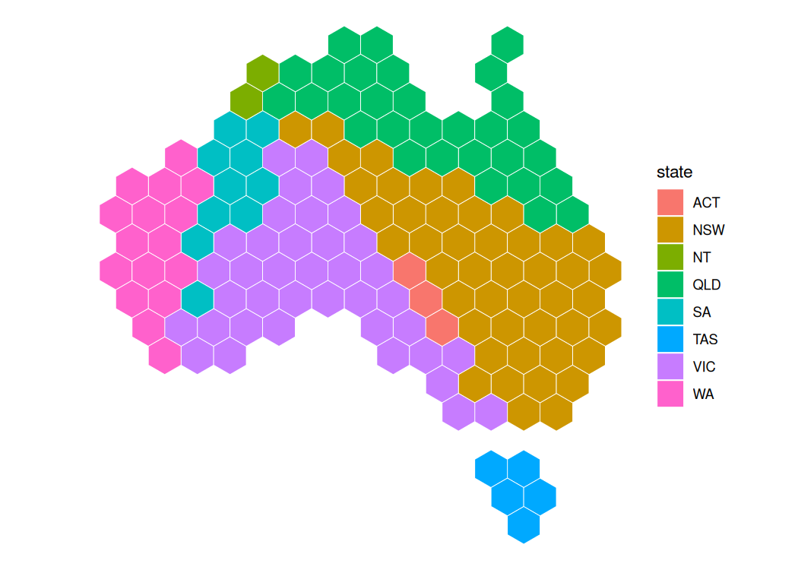
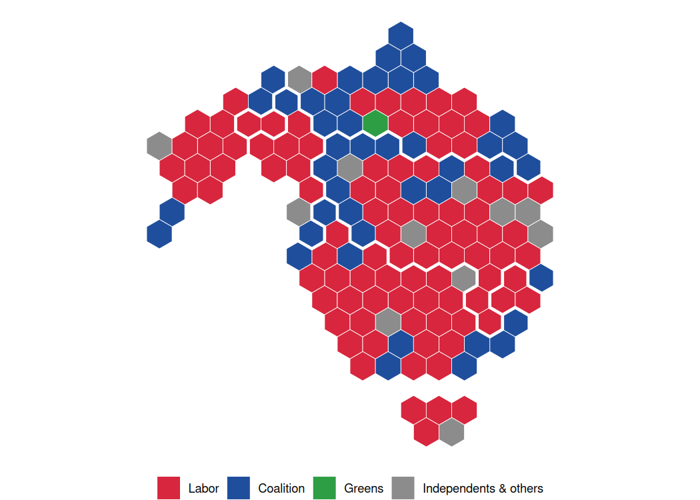

<!-- README.md is generated from README.Rmd. Please edit that file -->

# hexmap

<!-- badges: start -->

[](https://lifecycle.r-lib.org/articles/stages.html#experimental)
<!-- badges: end -->

The hexmap R package converts geospatial polygons into a map of equally
sized hexagons. Every region gets the same amount of ink, so small but
important regions (such as inner-city electorates) are as visible as
large, sparsely populated ones.

## Installation

You can install the development version of hexmap like so:

``` r
install.packages("remotes")
remotes::install_github("numbats/hexmap")
```

## Method

1.  **Tile** (`hex_grid()`): choose a hexagon size so that one hexagon
    per region covers the same area as the map, then keep the hexagons
    that overlap the map the most. Landmasses that are far enough apart
    (such as Tasmania and the mainland) are tiled separately and kept at
    least one hexagon apart.
2.  **Allocate** (`tile_allocate()`): give each region exactly one
    hexagon, minimising the total squared distance between regions and
    their hexagons. This optimal assignment is solved with the Hungarian
    algorithm. Optionally, regions can be grouped (e.g. by state) so
    that each group’s hexagons are contiguous.

When grouping, `hexmap()` first warps the map so that each group’s area
is proportional to its number of regions, which keeps the shape of each
group and the borders between them.

`hexmap()` does both steps in one call.

## Example: Australian federal election 2025

The `aec2025` data is an `sf` object with simplified boundaries of the
150 electoral divisions used at the 3 May 2025 Australian federal
election, and the party that won each division.

``` r
library(hexmap)
library(sf)
library(ggplot2)

party_colours <- c(ALP = "#D7263D", LNP = "#1F4E9C", GRN = "#2E9E44", Other = "#8C8C8C")
party_labels <- c(ALP = "Labor", LNP = "Coalition", GRN = "Greens", Other = "Independents & others")

winner_map <- function(data) {
  ggplot(data) +
    geom_sf(aes(fill = winner), colour = "white", linewidth = 0.2) +
    scale_fill_manual(values = party_colours, labels = party_labels, breaks = names(party_labels), name = NULL) +
    theme_void() +
    theme(legend.position = "bottom")
}
```

Labor won a large majority:

``` r
seats <- table(factor(aec2025$winner, levels = names(party_labels)))
data.frame(party = party_labels, seats = as.vector(seats), row.names = NULL)
#>                   party seats
#> 1                 Labor    94
#> 2             Coalition    43
#> 3                Greens     1
#> 4 Independents & others    12
```

### Choropleth map

On a geographic map the result looks like a Coalition landslide, because
the large rural divisions dominate the picture while Labor’s many small
city seats are barely visible.

``` r
aec2025 <- st_transform(aec2025, crs = 3577)
winner_map(aec2025)
```



### Hexagon map

The hexagon map gives every division the same area, so the map shows the
number of seats won by each party.

``` r
aec2025_hex <- hexmap(aec2025)
winner_map(aec2025_hex)
```



Colouring by state shows where the divisions have moved. The overall
shape of Australia and the relative positions of divisions are kept, but
the densely populated south-east has far more divisions than land, so
Victorian and Sydney divisions spill inland. Tasmania is tiled as a
separate island, with one hexagon for each of its five divisions.

``` r
ggplot(aec2025_hex) +
  geom_sf(aes(fill = state), colour = "white", linewidth = 0.2) +
  theme_void()
```



### Grouping by state

Grouping the divisions by state keeps each state’s hexagons together,
and a small gap along the state borders makes each state visually
distinct. To keep each state’s shape and position, the map is first
warped into a cartogram where each state’s area is proportional to its
number of divisions, and the hexagons are split between states along the
warped borders. This enlarges the densely populated south-east, while
Western Australia and the Northern Territory shrink.

``` r
aec2025_state_hex <- hexmap(aec2025, group = state)
winner_map(aec2025_state_hex)
```



## Related

- [`geogrid`](https://github.com/jbaileyh/geogrid) package
