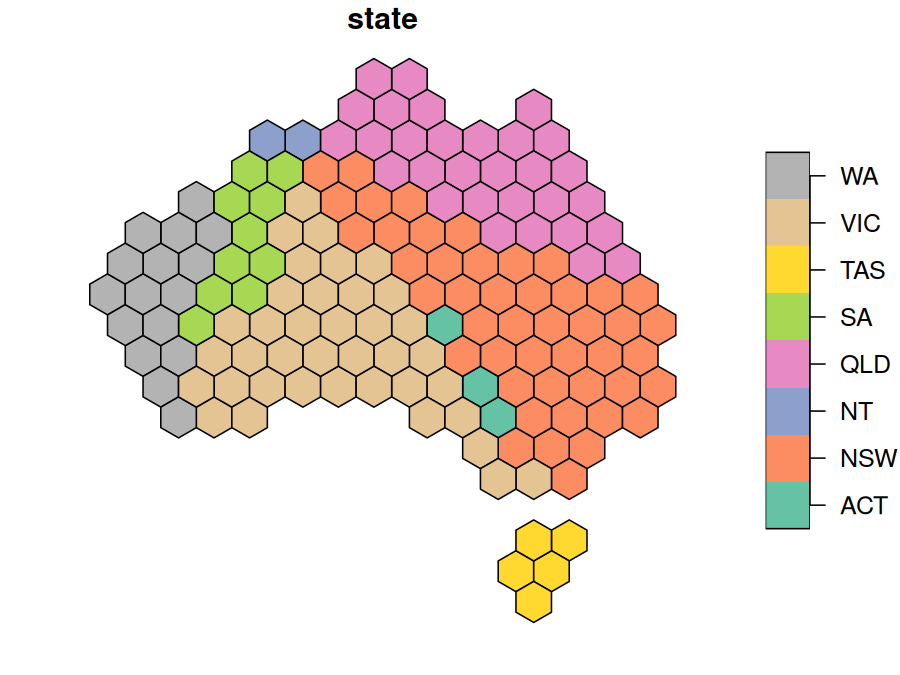
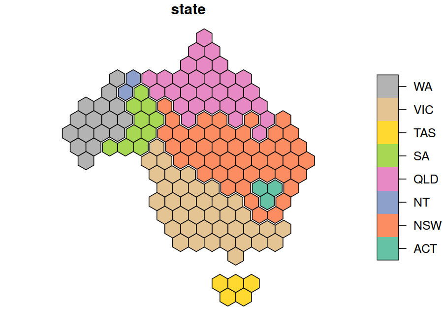
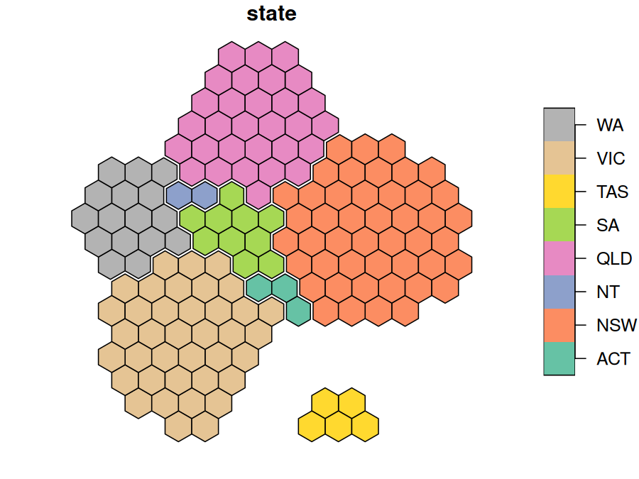
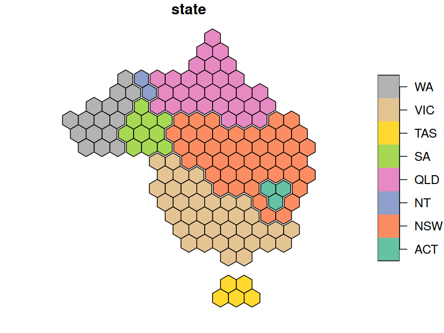
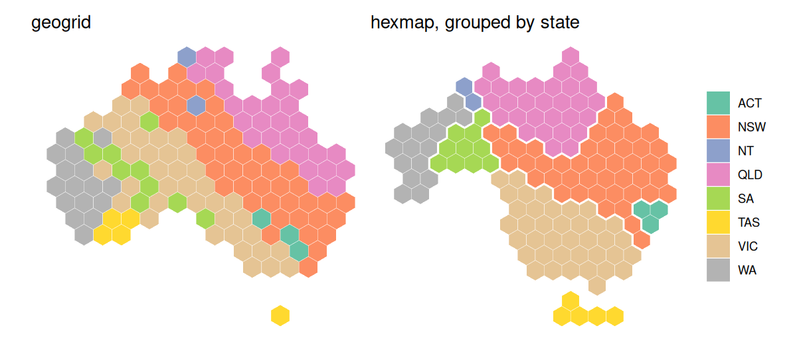

<!-- README.md is generated from README.Rmd. Please edit that file -->

# hexmap <a href="https://pkg.mitchelloharawild.com/hexmap/"></a>

<!-- badges: start -->

[](https://github.com/mitchelloharawild/hexmap/actions/workflows/R-CMD-check.yaml)
[](https://lifecycle.r-lib.org/articles/stages.html#experimental)
[](https://CRAN.R-project.org/package=hexmap)
<!-- badges: end -->

hexmap converts a map of regions into a map of equally sized hexagons,
one for each region. Every region gets the same amount of ink, so small
but important regions (such as inner-city electorates) are as visible as
large, sparsely populated ones, while each region stays close to where
it is on the map.

## Installation

Install the development version from GitHub with:

``` r
install.packages("remotes")
remotes::install_github("mitchelloharawild/hexmap")
```

## Usage

`hexmap()` replaces each region of an `sf` object with a hexagon,
keeping every other column and the order of the rows. Regions are placed
to keep their relative positions, and distant islands such as Tasmania
are tiled separately.

``` r
library(hexmap)
hex <- hexmap(aus_election_2025)
hex
#> Simple feature collection with 150 features and 3 fields
#> Geometry type: POLYGON
#> Dimension:     XY
#> Bounding box:  xmin: -2025236 ymin: -2169045 xmax: 1989468 ymax: 1694106
#> Projected CRS: +proj=laea +lat_0=-26.85 +lon_0=133.28
#> # A tibble: 150 × 4
#>    division  state party                                                geometry
#>  * <chr>     <chr> <chr>                                           <POLYGON [m]>
#>  1 Adelaide  SA    ALP   ((-930317.1 359562.8, -1051975 429801.9, -1051975 5702…
#>  2 Aston     VIC   ALP   ((286260 -483306.5, 164602.3 -413067.4, 164602.3 -2725…
#>  3 Ballarat  VIC   ALP   ((-1173633 -483306.5, -1295290 -413067.4, -1295290 -27…
#>  4 Banks     NSW   ALP   ((1137864 -694023.9, 1016206 -623784.8, 1016206 -48330…
#>  5 Barker    SA    LP    ((-930317.1 -61871.87, -1051975 8367.24, -1051975 1488…
#>  6 Barton    NSW   ALP   ((1259522 -904741.2, 1137864 -834502.1, 1137864 -69402…
#>  7 Bass      TAS   ALP   ((1259522 -1747611, 1137864 -1677371, 1137864 -1536893…
#>  8 Bean      ACT   ALP   ((772890.8 -904741.2, 651233.1 -834502.1, 651233.1 -69…
#>  9 Bendigo   VIC   ALP   ((-687001.7 359562.8, -808659.4 429801.9, -808659.4 57…
#> 10 Bennelong NSW   ALP   ((1137864 -272589.2, 1016206 -202350.1, 1016206 -61871…
#> # ℹ 140 more rows
plot(hex["state"])
```



Use `group` to keep the hexagons of each group, such as a state,
together and touching the same neighbouring groups as on the map:

``` r
hex <- hexmap(aus_election_2025, group = state)
plot(hex["state"])
```



Use `layout` to choose how the groups are arranged. See
[`vignette("layouts")`](https://pkg.mitchelloharawild.com/hexmap/articles/layouts.html)
for how the layouts compare.

``` r
hex <- hexmap(aus_election_2025, group = state, layout = layout_compact())
plot(hex["state"])
```



The hexagons are regular in the projection they are made in, which is an
equal-area projection for longitude/latitude maps unless you choose one
with `crs`. See
[`vignette("projections")`](https://pkg.mitchelloharawild.com/hexmap/articles/projections.html).

``` r
hex <- hexmap(aus_election_2025, group = state, crs = 3577)
plot(hex["state"])
```



Given a geometry column, `hexmap()` returns a geometry column of
hexagons, so you can keep both:

``` r
aus_election_2025 |>
  dplyr::mutate(hex = hexmap(geometry, group = state))
#> Simple feature collection with 150 features and 3 fields
#> Active geometry column: geometry
#> Geometry type: MULTIPOLYGON
#> Dimension:     XY
#> Bounding box:  xmin: 112.9282 ymin: -43.63201 xmax: 153.6299 ymax: -10.0599
#> Geodetic CRS:  GDA2020
#> # A tibble: 150 × 5
#>    division  state party                      geometry                       hex
#>  * <chr>     <chr> <chr>            <MULTIPOLYGON [°]>             <POLYGON [m]>
#>  1 Adelaide  SA    ALP   (((138.6264 -34.96455, 138.6… ((-194541.5 263194.1, -1…
#>  2 Aston     VIC   ALP   (((145.3043 -37.82152, 145.2… ((983055.9 -1368533, 983…
#>  3 Ballarat  VIC   ALP   (((144.4153 -37.38247, 144.3… ((-194541.5 -552669.3, -…
#>  4 Banks     NSW   ALP   (((151.0724 -33.92941, 150.9… ((1218575 -552669.3, 121…
#>  5 Barker    SA    LP    (((138.8476 -34.68052, 138.9… ((-430061 -144737.6, -43…
#>  6 Barton    NSW   ALP   (((151.1301 -33.98377, 151.1… ((1701390 -967399.9, 170…
#>  7 Bass      TAS   ALP   (((148.116 -40.51267, 148.11… ((1218575 -2184396, 1218…
#>  8 Bean      ACT   ALP   (((148.8042 -35.71401, 148.8… ((1571855 -756635.2, 167…
#>  9 Bendigo   VIC   ALP   (((144.8124 -37.21391, 144.8… ((-312301.3 -348703.5, -…
#> 10 Bennelong NSW   ALP   (((151.0733 -33.81869, 151.1… ((1336335 -348703.5, 133…
#> # ℹ 140 more rows
```

## Example: the 2025 Australian federal election

Labor won 94 of the 150 seats at the 2025 Australian federal election.
On a geographic map the result looks like a Coalition win, as the large
rural divisions hide Labor’s many small city seats. A cartogram produced
with [cartogram](https://github.com/sjewo/cartogram), which distorts
regions so their areas are proportional to a variable, can give each
division an equal area to show the number of seats, but it distorts the
map beyond recognition. A hexagon grid produced with
[geogrid](https://github.com/jbaileyh/geogrid), which allocates regions
to a regular grid of hexagons or squares, gives each division the same
space, but doesn’t keep states together. hexmap keeps each state
together, in its place and with its neighbours.


The results are included as `aus_election_2025`: the simplified
boundaries of each division from the [Australian Bureau of
Statistics](https://www.abs.gov.au/), with its state and winning party
from the [Australian Electoral Commission](https://www.aec.gov.au/) (CC
BY 4.0). The maps below use the Australian Albers equal-area projection,
with minor parties combined:

``` r
library(sf)
library(hexmap)

party <- c(ALP = "Labor", LP = "Coalition", LNP = "Coalition", NP = "Coalition",
           GRN = "Greens")
election <- st_transform(aus_election_2025, 3577)
election$party <- ifelse(election$party %in% names(party), party[election$party], "Other")
```

Each method gives every division the same area:

``` r
library(cartogram)
library(geogrid)

# Cartogram
election$seats <- 1
election_cartogram <- cartogram_cont(election, "seats", itermax = 20)

# geogrid
grid <- calculate_grid(election, grid_type = "hexagonal", seed = 1)
election_geogrid <- assign_polygons(election, grid)

# hexmap
election_hexmap <- hexmap(election, group = state)
```


Colouring the divisions by state shows the difference: geogrid scatters
each state’s divisions across the grid, putting four of Tasmania’s five
seats on the mainland, while hexmap keeps each state in one piece,
touching the same states as on the map.


