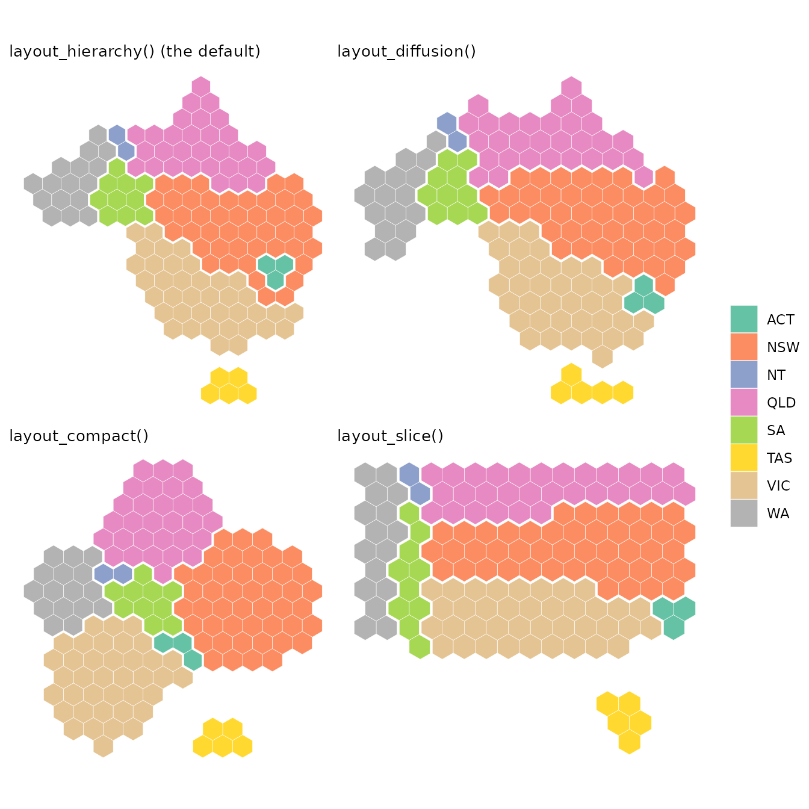
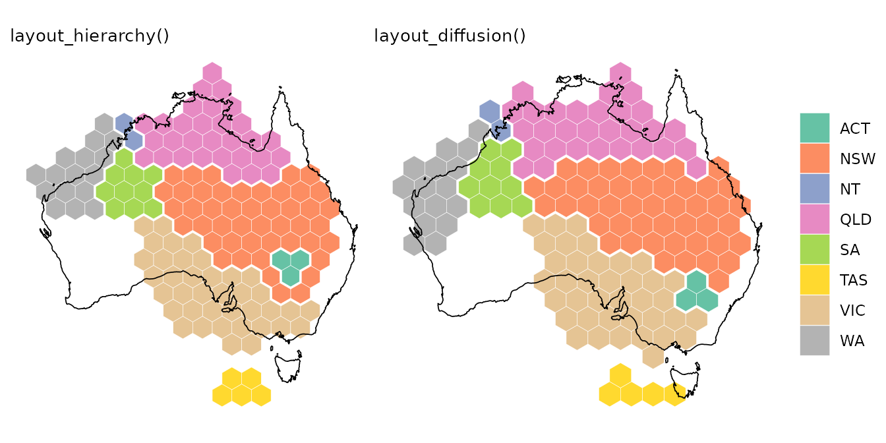
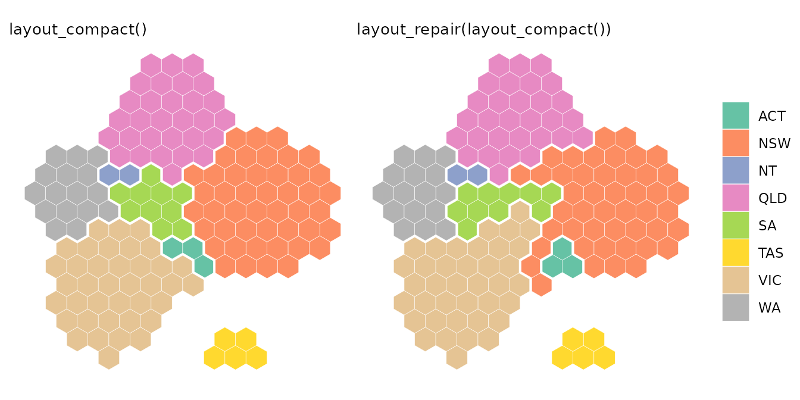
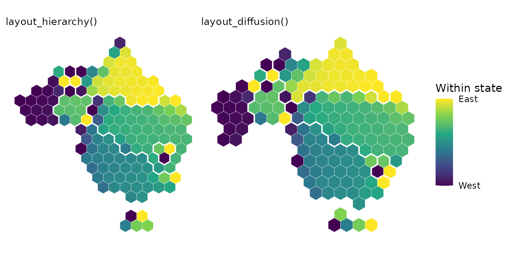

# Choosing a layout for groups

``` r

library(hexmap)
library(sf)
library(ggplot2)
```

When regions are grouped, such as electoral divisions into states,
[`hexmap()`](https://pkg.mitchelloharawild.com/hexmap/reference/hexmap.md)
keeps the hexagons of each group together. Groups rarely need the same
space in hexagons as they cover on the map: New South Wales has 46 of
the 150 divisions at the 2025 Australian federal election, but only a
tenth of the land, while Western Australia has a third of the land but
only 16 divisions. The map has to be distorted to fit, and `layout`
chooses how.

Each layout keeps some things and gives up others:

- the **outline** of the whole map, such as the coastline of Australia;
- the **shape of each group**, such as the triangle of Tasmania or the
  long coast of Queensland;
- the **position of each group**, so that each group is in the right
  direction from the others and touches the same groups as on the map;
- the **position of regions within each group**, so that a state’s
  northern divisions are at the top of its hexagons, and its city
  divisions stay together.

The examples use the 2025 election results included in hexmap, in the
Australian Albers equal-area projection:

``` r

election <- st_transform(aus_election_2025, 3577)
```

## The layouts

``` r

hierarchy <- hexmap(election, group = state)
diffusion <- hexmap(election, group = state, layout = layout_diffusion())
compact <- hexmap(election, group = state, layout = layout_compact())
slice <- hexmap(election, group = state, layout = layout_slice())
```



- **[`layout_hierarchy()`](https://pkg.mitchelloharawild.com/hexmap/reference/layouts.md)**,
  the default, places the groups first and then the regions within each
  group. Each group keeps its own shape, in the right direction from its
  neighbours, at the expense of the outline of the whole map. It is the
  slowest layout.
- **[`layout_diffusion()`](https://pkg.mitchelloharawild.com/hexmap/reference/layouts.md)**
  stretches and squeezes the whole map, like a rubber sheet, until each
  group has the space it needs. It keeps more of the outline of the map
  than
  [`layout_hierarchy()`](https://pkg.mitchelloharawild.com/hexmap/reference/layouts.md),
  but bends the shapes of groups more, and places regions within groups
  less accurately. It is usually faster than
  [`layout_hierarchy()`](https://pkg.mitchelloharawild.com/hexmap/reference/layouts.md),
  by up to twice.
- **[`layout_compact()`](https://pkg.mitchelloharawild.com/hexmap/reference/layouts.md)**
  draws each group as a round block of hexagons, packed together like a
  hand drawn election map. Blocks are easy to compare, but the shape of
  each group and the outline of the map are lost, and neighbouring
  blocks don’t always touch where the groups do. It is the fastest
  layout.
- **[`layout_slice()`](https://pkg.mitchelloharawild.com/hexmap/reference/layouts.md)**
  cuts a rectangle into a piece for each group, so groups are separated
  by straight lines. Every landmass becomes a rectangle, losing features
  such as Cape York and the Great Australian Bight, and groups lose
  their shapes as much as in the compact layout. It is nearly as fast as
  [`layout_compact()`](https://pkg.mitchelloharawild.com/hexmap/reference/layouts.md).

## Outline and shape

[`layout_diffusion()`](https://pkg.mitchelloharawild.com/hexmap/reference/layouts.md)
keeps the outline of the map, while
[`layout_hierarchy()`](https://pkg.mitchelloharawild.com/hexmap/reference/layouts.md)
keeps the shape of each group. Outlining Australia, scaled to the area
of the hexagons, shows the difference: the diffusion layout fills more
of the coastline, while the hierarchy layout lets the outline go so that
each state looks like itself. Queensland, for instance, keeps Cape York
as its northern tip in the hierarchy layout, but is stretched into a
band along the top of the map in the diffusion layout.



To keep even more of the outline, `layout_diffusion(cartogram = 0)`
squeezes the groups into the outline of the map as it is, at the cost of
bending their shapes further.

## Position of each group

Both
[`layout_hierarchy()`](https://pkg.mitchelloharawild.com/hexmap/reference/layouts.md)
and
[`layout_diffusion()`](https://pkg.mitchelloharawild.com/hexmap/reference/layouts.md)
keep each group in the right direction from the others, with
[`layout_hierarchy()`](https://pkg.mitchelloharawild.com/hexmap/reference/layouts.md)
slightly more accurate on most maps. The compact layout is the least
accurate, as round blocks have to be pushed apart to fit together. They
differ in which groups touch. On this map,
[`layout_hierarchy()`](https://pkg.mitchelloharawild.com/hexmap/reference/layouts.md)
makes every state touch exactly the states it borders. The diffusion
layout lets the ACT touch Victoria, and the compact layout gets five
pairs of states wrong: the ACT touches South Australia and Victoria,
Western Australia touches Queensland and Victoria, and New South Wales
and Victoria don’t touch.

[`layout_repair()`](https://pkg.mitchelloharawild.com/hexmap/reference/layouts.md)
takes any layout and swaps hexagons across the borders between groups
until groups touch as they do on the map. It fixes the ACT in the
diffusion layout, and three of the five mistakes in the compact layout:

``` r

repaired <- hexmap(election, group = state,
                   layout = layout_repair(layout_compact()))
```



Repairing only swaps hexagons along the borders between groups, keeping
the hexagons of the layout, so it can’t move whole blocks: Western
Australia still reaches across to touch Queensland and Victoria.
[`layout_hierarchy()`](https://pkg.mitchelloharawild.com/hexmap/reference/layouts.md)
makes the same swaps as it places the groups, so it doesn’t need
repairing.

## Position of regions within groups

[`layout_hierarchy()`](https://pkg.mitchelloharawild.com/hexmap/reference/layouts.md)
places the regions of each group by fitting the group’s shape on the map
to the shape of its hexagons, so on most maps, regions keep their order
within each group better than with the other layouts. Colouring each
division by how far east it is within its state shows the order. Both
layouts keep Perth in the west of Western Australia and Brisbane in the
east of Queensland, but the hierarchy layout keeps more of the outback
in Queensland’s west.



To measure the order, compare the rank of each division from west to
east (and from south to north) on the map with its rank in the hexagons
of its state. A rank correlation of 1 means that every division is in
the same order:

``` r

order_kept <- function(hex) {
  map <- st_coordinates(st_point_on_surface(st_geometry(election)))
  tile <- st_coordinates(st_centroid(st_geometry(hex)))
  states <- split(seq_len(nrow(map)), election$state)
  states <- states[lengths(states) >= 4]
  mean(sapply(states, function(i) {
    cor(map[i, ], tile[i, ], method = "spearman")[c(1, 4)]
  }))
}
sapply(list(hierarchy = hierarchy, diffusion = diffusion,
            compact = compact, slice = slice), order_kept)
#> hierarchy diffusion   compact     slice 
#> 0.8503230 0.7439315 0.8270797 0.7515242
```

Across the whole map, the hierarchy and diffusion layouts move regions
by about the same distance from where they are on the map. The hierarchy
layout keeps regions in order within groups, while the diffusion layout
keeps more of the outline.

## Which to choose

|  | Outline of the map | Shape of each group | Position of each group | Regions within groups | Speed |
|----|----|----|----|----|----|
| [`layout_hierarchy()`](https://pkg.mitchelloharawild.com/hexmap/reference/layouts.md) | Fair | Best | Best | Best | Slowest |
| [`layout_diffusion()`](https://pkg.mitchelloharawild.com/hexmap/reference/layouts.md) | Best | Good | Good | Good | Medium |
| [`layout_compact()`](https://pkg.mitchelloharawild.com/hexmap/reference/layouts.md) | Poor | Poor | Fair | Good | Fastest |
| [`layout_slice()`](https://pkg.mitchelloharawild.com/hexmap/reference/layouts.md) | Rectangle | Poor | Good | Fair | Fast |

The table summarises how the layouts compare across five maps:
Australian electoral divisions and local government areas, US states and
counties, and the countries of the world. The ratings are relative to
each other, and one map can differ from the overall pattern. On the
world map, for instance, with a few large groups,
[`layout_diffusion()`](https://pkg.mitchelloharawild.com/hexmap/reference/layouts.md)
keeps the shapes of the continents better than
[`layout_hierarchy()`](https://pkg.mitchelloharawild.com/hexmap/reference/layouts.md).

- Use
  [`layout_hierarchy()`](https://pkg.mitchelloharawild.com/hexmap/reference/layouts.md),
  the default, when the groups should be recognisable and in the right
  places, such as states on an election map.
- Use
  [`layout_diffusion()`](https://pkg.mitchelloharawild.com/hexmap/reference/layouts.md)
  when the outline of the whole map matters more than the shape of each
  group, or for a faster layout.
- Use
  [`layout_compact()`](https://pkg.mitchelloharawild.com/hexmap/reference/layouts.md)
  or
  [`layout_slice()`](https://pkg.mitchelloharawild.com/hexmap/reference/layouts.md)
  for a stylised map, where the groups are easy to compare but don’t
  need to look like themselves. Wrap them in
  [`layout_repair()`](https://pkg.mitchelloharawild.com/hexmap/reference/layouts.md)
  so that groups touch as they do on the map.
