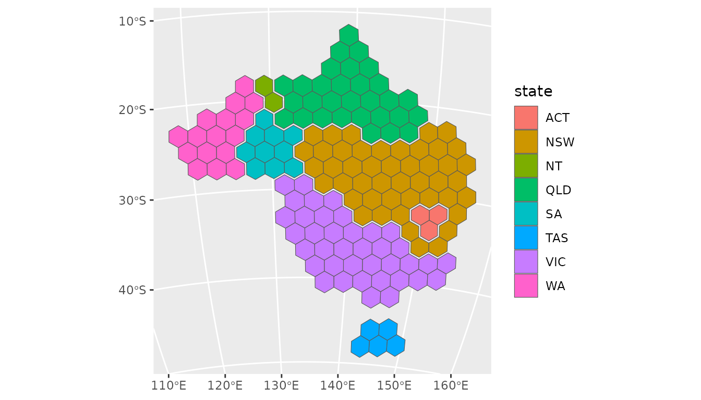
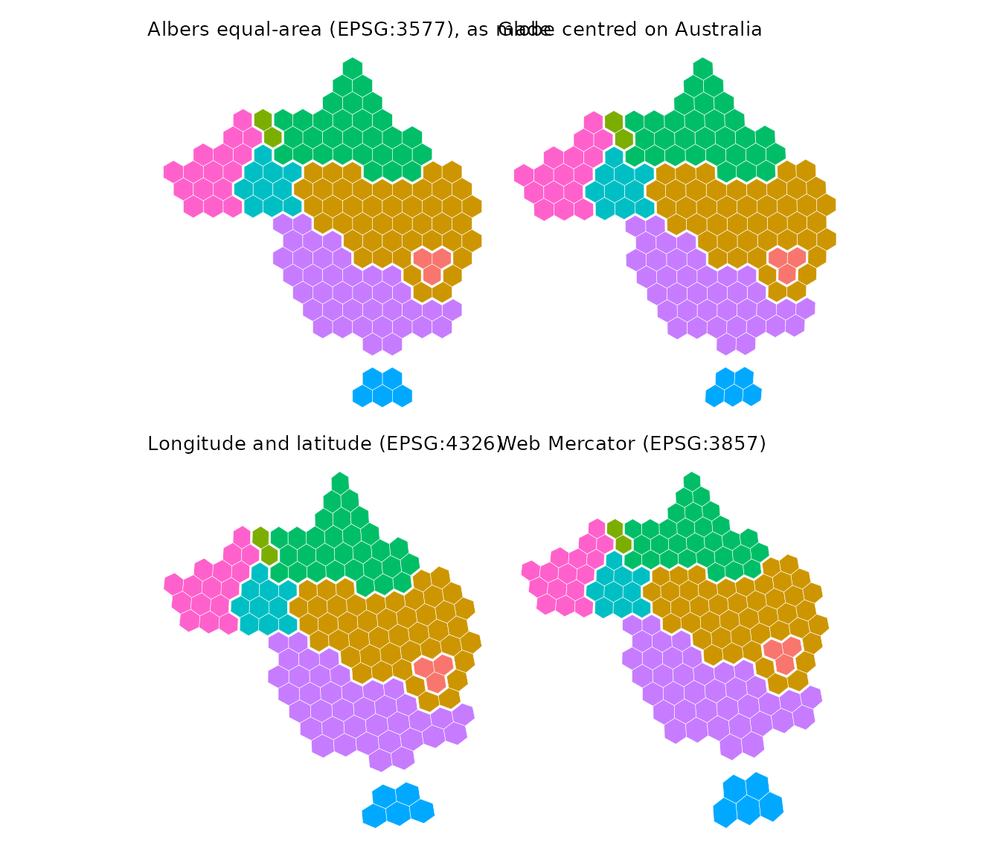
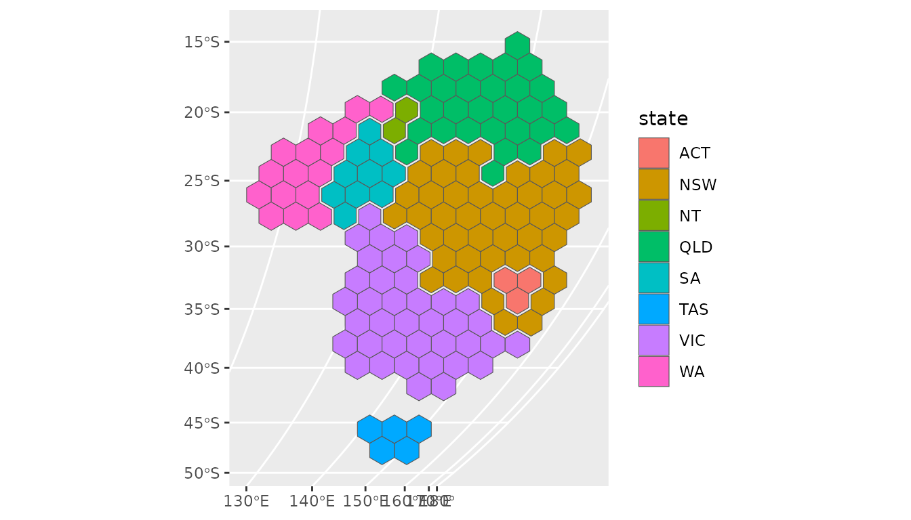
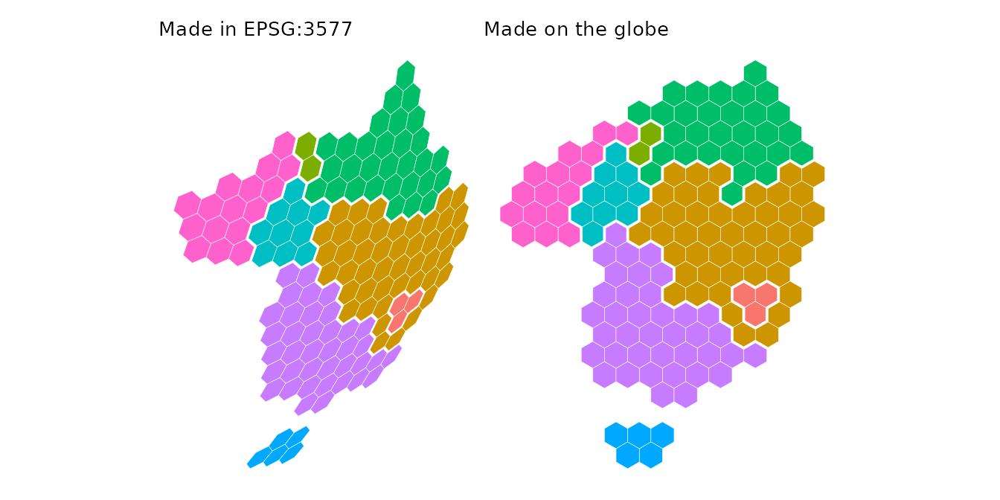

# Hexagon maps and map projections

``` r

library(hexmap)
library(sf)
library(ggplot2)
```

The examples use the electoral divisions of the 2025 Australian federal
election included in hexmap, in longitude and latitude, with the state
of each division:

``` r

ced <- aus_election_2025
```

A hexagon map is drawn on a flat surface, but the regions it represents
lie on the curved surface of the Earth. The projection that flattens the
Earth decides two things about the hexagons:

- whether they look **regular**, with six equal sides, and
- whether they cover **equal areas on the ground**.

[`hexmap()`](https://numbats.github.io/hexmap/reference/hexmap.md) makes
regular, equally sized hexagons in the plane of a projected coordinate
reference system (CRS). This is the CRS of the map, or the one given
with `crs`. A map in longitude and latitude has no plane to make
hexagons in, so by default it is projected with the Lambert azimuthal
equal-area projection centred on the map, and a message names the CRS
chosen. The hexagons are ordinary `sf` polygons, so they keep their
location on the Earth and can be plotted with
[`geom_sf()`](https://ggplot2.tidyverse.org/reference/ggsf.html) in any
projection. They only look regular when plotted in the projection they
were made in, and only cover equal areas on the ground when that
projection is equal-area.

``` r

ced_hex <- hexmap(ced, group = state, crs = 3577)
ggplot(ced_hex) +
  geom_sf(aes(fill = state))
```


## Plotting in other projections

Plotting the hexagons in another projection moves each of their corners
to its new position, so the hexagons stay in place but are stretched
with the land beneath them. For example, on a globe centred on
Australia:

``` r

ggplot(ced_hex) +
  geom_sf(aes(fill = state)) +
  coord_sf(crs = "+proj=ortho +lat_0=-25 +lon_0=134")
```



The same hexagons in some other projections:



A globe centred on Australia is close to the Albers projection across
the continent, so the hexagons are barely changed. Longitude and
latitude shears them, and Web Mercator keeps their shape but enlarges
them towards the south.

## Regular hexagons on a globe

On a globe centred away from Australia, the continent is foreshortened
towards the horizon, and so are hexagons made in the Albers projection.
To have regular hexagons on the plotted map, make them in the projection
it will be plotted in.

``` r

globe <- "+proj=ortho +lat_0=0 +lon_0=90"
globe_hex <- hexmap(ced, group = state, crs = globe)
ggplot(globe_hex) +
  geom_sf(aes(fill = state))
```



Compared with the Albers hexagons plotted on the same globe:



The hexagons made on the globe are regular, and tile the outline of
Australia as it appears from this viewpoint. The hexagon size,
`island_gap`, `group_gap` and the group layouts are all measured in the
plane of this projection.

An orthographic globe only shows one hemisphere, so centre it well away
from the region. Hexagons on the edge of a region near the horizon may
extend past it, where they have no location on the Earth.

## Equally sized hexagons

The hexagons are equally sized in the plane they are made in. They also
cover equal areas on the ground when that projection is **equal-area**.
Making and plotting the hexagons in an equal-area projection gives
hexagons that look regular and represent equal areas, for example:

- an equal-area conic projection for a country or state, such as the
  Australian Albers (EPSG:3577) or the conterminous United States Albers
  (EPSG:5070),
- the Lambert azimuthal equal-area projection centred on the region
  (`"+proj=laea +lat_0=... +lon_0=..."`), which looks like a globe near
  its centre and is the default for maps in longitude and latitude,
- Equal Earth (`"+proj=eqearth"`) or Mollweide (`"+proj=moll"`) for the
  whole world.

The orthographic globe is not equal-area, but is close to it near its
centre. Web Mercator is far from equal-area. Over Australia, its
hexagons cover up to 1.75 times as much ground in the tropical north as
in Tasmania.
