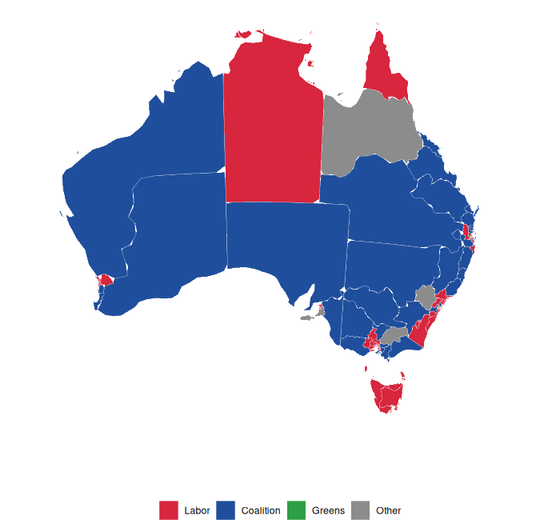
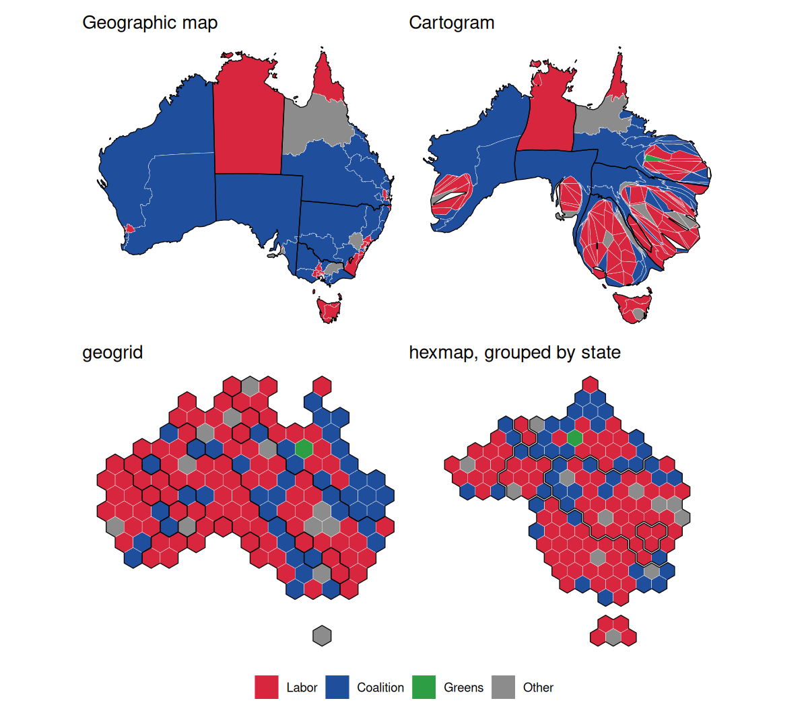
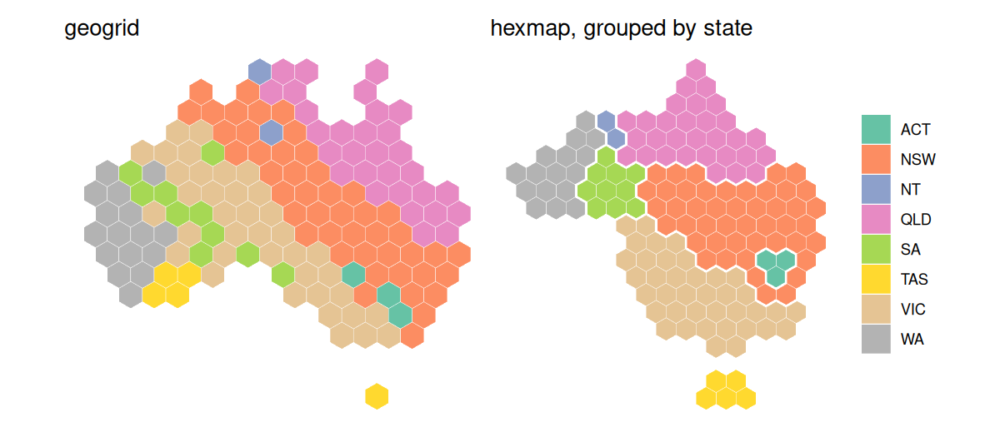

# hexmap

hexmap converts a map of regions into a map of equally sized hexagons,
one for each region. Every region gets the same amount of ink, so small
but important regions (such as inner-city electorates) are as visible as
large, sparsely populated ones, while each region stays close to where
it is on the map.

## Installation

You can install the development version of hexmap like so:

``` r

install.packages("remotes")
remotes::install_github("numbats/hexmap")
```

## Usage

[`hexmap()`](https://numbats.github.io/hexmap/reference/hexmap.md) takes
an `sf` object and returns it with each region’s geometry replaced by a
hexagon:

``` r

library(hexmap)
hexmap(electorates)
hexmap(electorates, group = state)
```

- **Optimal placement.** Each region gets the hexagon that minimises the
  total squared distance between regions and their hexagons, so the
  relative positions of regions are kept.

- **Groups.** With `group`, the hexagons of each group (such as a state)
  are kept together, separated by a small gap (`group_gap`), and touch
  the same neighbouring groups as on the map.

- **Layouts.** `layout` sets how the hexagons and groups are arranged:
  groups that keep their own shapes and positions
  ([`layout_hierarchy()`](https://numbats.github.io/hexmap/reference/layouts.md),
  the default), a cartogram that keeps more of the overall outline
  ([`layout_diffusion()`](https://numbats.github.io/hexmap/reference/layouts.md)),
  compact blocks
  ([`layout_compact()`](https://numbats.github.io/hexmap/reference/layouts.md)),
  or a spatial treemap
  ([`layout_slice()`](https://numbats.github.io/hexmap/reference/layouts.md)).
  [`layout_repair()`](https://numbats.github.io/hexmap/reference/layouts.md)
  fixes the borders between groups of any layout. See
  [`vignette("layouts")`](https://numbats.github.io/hexmap/articles/layouts.md)
  for how they compare.

- **Islands.** Distant landmasses, such as Tasmania, are tiled
  separately and kept apart from the mainland (`island_gap`).

- **Projections.** Hexagons are regular in the projection they are made
  in (`crs`), which defaults to an equal-area projection for maps in
  longitude and latitude. See
  [`vignette("projections")`](https://numbats.github.io/hexmap/articles/projections.md).

- **Keeps your data.**
  [`hexmap()`](https://numbats.github.io/hexmap/reference/hexmap.md)
  returns the map with each region’s geometry replaced by its hexagon,
  keeping every other column and the order of the rows, so the hexagons
  are easy to join to or compare with the regions. Given a geometry
  column instead, it returns a geometry column of hexagons, so it can be
  used in
  [`dplyr::mutate()`](https://dplyr.tidyverse.org/reference/mutate.html)
  to keep both:

  ``` r

  electorates |>
    dplyr::mutate(hex = hexmap(geometry, group = state))
  ```

## Example: the 2025 Australian federal election

Labor won 94 of the 150 seats at the 2025 Australian federal election.
On a geographic map the result looks like a Coalition win, as the large
rural divisions hide Labor’s many small city seats. A cartogram with
equal areas for each division shows the number of seats, but distorts
the map beyond recognition. A hexagon grid made with
[geogrid](https://github.com/jbaileyh/geogrid) gives each division the
same space, but doesn’t keep states together. hexmap keeps each state
together, in its place and with its neighbours.



hexmap includes the results as `aus_election_2025`: the simplified
boundaries of each division from the [Australian Bureau of
Statistics](https://www.abs.gov.au/), with its state and the party that
won it from the [Australian Electoral
Commission](https://www.aec.gov.au/), licensed under CC BY 4.0. The maps
below are made in the Australian Albers equal-area projection, with the
minor parties combined:

``` r

library(sf)
library(hexmap)

party <- c(ALP = "Labor", LP = "Coalition", LNP = "Coalition", NP = "Coalition",
           GRN = "Greens")
election <- st_transform(aus_election_2025, 3577)
election$party <- ifelse(election$party %in% names(party), party[election$party], "Other")
```

Each method then gives every division the same area:

``` r

library(cartogram)
library(geogrid)

# Cartogram
election$seats <- 1
election_cartogram <- cartogram_cont(election, "seats", itermax = 20)

# geogrid
grid <- calculate_grid(election, grid_type = "hexagonal", seed = 1)
election_geogrid <- assign_polygons(election, grid)

# hexmap
election_hexmap <- hexmap(election, group = state)
```



Colouring the divisions by state shows the difference. geogrid scatters
the divisions of each state across the grid, so four of Tasmania’s five
seats end up on the mainland. hexmap keeps each state in one piece,
touching the same states as on the map.



The code for the plots (with ggplot2 and patchwork) is in
[`README.Rmd`](https://numbats.github.io/hexmap/README.Rmd).

## Related

- [geogrid](https://github.com/jbaileyh/geogrid) allocates regions to a
  regular grid of hexagons or squares.
- [cartogram](https://github.com/sjewo/cartogram) distorts regions so
  their areas are proportional to a variable.
